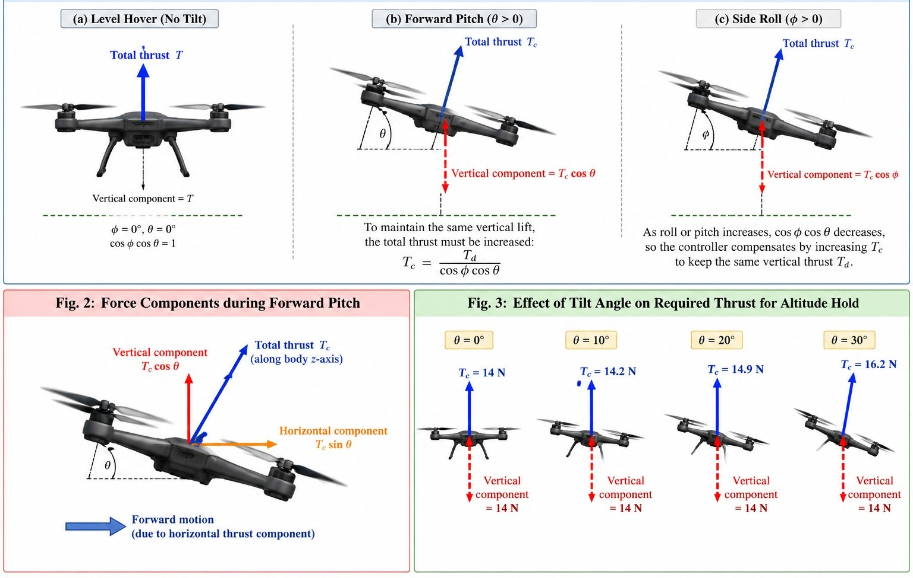
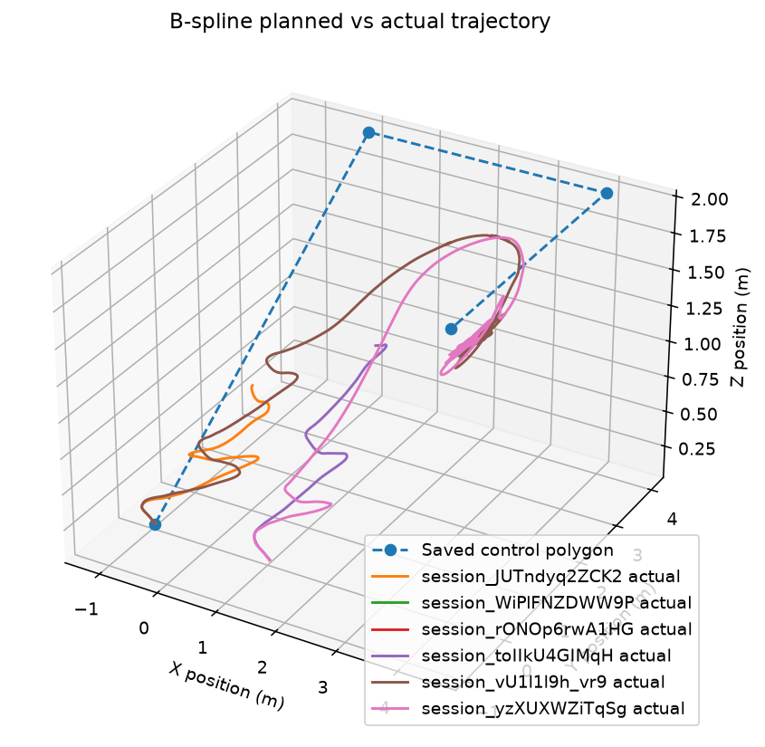
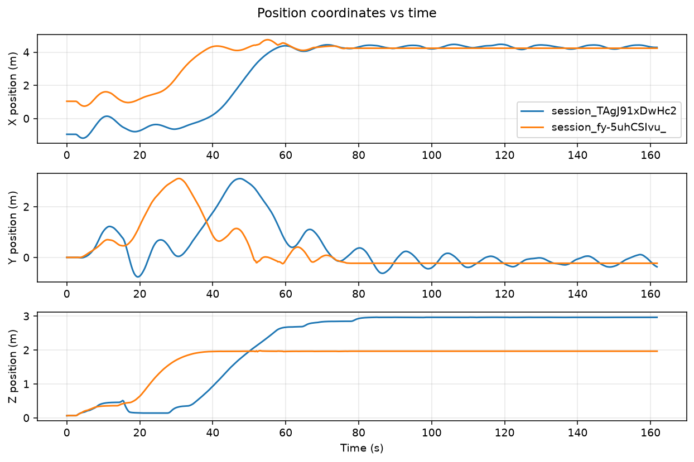

  <figure>
      
  </figure>

# IDDCD_CD3_Dynamic_Leader_Switching

# Group & Team Members
<table>
  <tr>
 <td colspan="3">Group - 2</td>

  </tr>
  <tr class="header">
    <td>Name</td>
    <td>Roll No</td>
    <td>Email-Id</td>
  </tr>
  <tr>
    <td>Advaith Krishna</td>
    <td>CB.SC.U4AIE24203</td>
    <td>cb.sc.u4aie24203@cb.students.amrita.edu</td>
  </tr>
  <tr>
    <td>Amudala Jashwanth</td>
    <td>CB.SC.U4AIE24204</td>
    <td>cb.sc.u4aie24204@cb.students.amrita.edu</td>
  </tr>
  <tr>
    <td>Bhuvan Rajasekar</td>
    <td>CB.SC.U4AIE24209</td>
    <td>cb.sc.u4aie24209@cb.students.amrita.edu</td>
  </tr>
  <tr>
    <td>Sachcith G N</td>
    <td>CB.SC.U4AIE24251</td>
    <td>cb.sc.u4aie24251@cb.students.amrita.edu</td>
  </tr>
</table>

## Abstract

Cooperative navigation of multiple Unmanned Aerial Vehicles (UAVs) commonly relies on a fixed leader-follower architecture, where one UAV continuously performs the leader role while the other follows its navigation commands. Although simple, this approach can reduce mission reliability when the leader experiences battery depletion, degraded positioning, communication loss, strong wind disturbances, or reduced environmental awareness.

This project proposes an Adaptive Dynamic Leader Switching framework for dual-UAV cooperative navigation, where leadership is dynamically assigned according to the real-time operational health of each UAV. A Multi-Criteria Health Assessment model evaluates battery level, GPS confidence, obstacle visibility, communication quality, mission progress, and wind stability. These factors are normalized and combined to generate a leadership score for each UAV. The UAV with the more favorable operational condition is selected as the leader.

To prevent unnecessary switching caused by measurement fluctuations, the framework incorporates score hysteresis(switching threshold/margin) and a minimum leader dwell time. When leadership changes, the new leader continues the mission trajectory while the previous leader transitions to follower mode, maintaining formation continuity. The system is implemented and evaluated in a multi-UAV simulation environment using position control, quaternion-based attitude control, and motor-level dynamics.

## Base Paper Metadata

- Journal: IEEE Transactions on Systems, Man, and Cybernetics: Systems
- Volume: 47
- Issue: 7
- Year: 2017
- Pages: 1217–1228
- DOI: 10.1109/TSMC.2016.2564931
- Publisher: IEEE
- Authors: Feng Li, Yongsheng Ding, MengChu Zhou, Lei Chen

## Base Paper Discussion

The paper proposes a dynamic leader-selection mechanism to overcome the limitations of fixed leader–follower formation control. The system uses a Fuzzy Inference System (FIS) to evaluate the status of individual robots and an affection-based model to determine when the current leader should be replaced. Followers generate unsatisfied signals based on their perception of the leader, and leader reselection is triggered when the accumulated dissatisfaction exceeds a predefined threshold. A swap-greedy algorithm is then used to establish the new leader–follower relationships while reducing overall travel distance.

The paper demonstrates through simulations that the proposed approach can autonomously recover from leader failures and continue mission execution. It also shows that delaying leader switching helps prevent excessive switching and instability.

However, the approach is designed for general multirobot systems and its leader-selection decision is primarily based on the affection/status model rather than an explicit, physically interpretable multi-criteria UAV health assessment. Furthermore, the paper assumes unrestricted communication and identifies limited communication and switching topology as future research challenges.

Our project extends this concept to dual-UAV cooperative navigation by replacing the affection-based selection mechanism with a measurable leadership score based on battery level, GPS confidence, communication quality, obstacle visibility, mission progress, and wind stability.

## Problem Statement
Conventional dual-UAV leader-follower systems use a fixed leader, creating a single point of failure when its battery, localization, communication, sensing, or stability deteriorates.
A dynamic mechanism is required to evaluate both UAVs using multiple operational criteria and identify the most suitable leader during the mission.
The system must switch leadership reliably without unnecessary chattering while maintaining formation and mission continuity.

## Novelty

| **No.** | **Novelty of Proposed Project**            | **Difference from Previous Paper**                                                                                                                                                        |
| ------- | ------------------------------------------ | ----------------------------------------------------------------------------------------------------------------------------------------------------------------------------------------- |
| 1   | Multi-criteria UAV health assessment   | Uses battery, GPS confidence, obstacle visibility, communication quality, mission progress, and wind stability for leader selection.                                                      |
| 2   | Error-based leadership score | Replaces the previous affection/fuzzy-based selection concept with a quantitative weighted leadership score.                                                                              |
| 3   | Stable leader switching                | Introduces hysteresis and minimum dwell time to prevent unnecessary leader switching and chattering.                                                                                  |
| 4   | UAV-specific cooperative navigation    | Integrates dynamic leader switching with quaternion attitude control, position control, quadrotor dynamics, and Webots simulation while maintaining formation and mission continuity. |

## Project Objectives

1. To Develop a drone controlling python script which controls the attitude of the Drone.
2. Formulate an adaptive leadership score using battery level, position accuracy, communication status, and mission progress.
3. Design a hysteresis-based dynamic leader-selection mechanism with a minimum dwell time.
4. Integrate dynamic leader switching with dual-UAV leader-follower cooperative navigation.

## Brief Project Explanation

This project proposes an adaptive dynamic leader-switching system for two UAVs in cooperative navigation. Unlike a conventional fixed leader-follower system, the proposed method continuously evaluates the UAVs using information already available from the simulation and flight-control system, such as battery level, GPS/position accuracy, communication status, and mission progress.

A leadership score is calculated for each UAV based on these parameters. When the current leader becomes less suitable and the other UAV has a sufficiently higher score, leadership is transferred. Hysteresis and minimum dwell time are used to avoid unnecessary or rapid switching.

After switching, the new leader continues following the mission trajectory, while the previous leader automatically becomes the follower and maintains the required formation relative to the new leader.

## Methodology

### Part 1 — UAV State Estimation and B-Spline Trajectory Generation

#### 1. UAV State Monitoring

The Webots controller obtains the UAV's position and orientation from the simulated sensors. Its state information can be represented as:

$$
\mathbf{x}=
\begin{bmatrix}
\mathbf{p}\\
\mathbf{v}\\
\mathbf{q}\\
\boldsymbol{\omega}
\end{bmatrix}
$$

where:

- $\mathbf{x}$: UAV state representation.
- $\mathbf{p}=[x,y,z]^T$: current 3D position from GPS.
- $\mathbf{v}=[v_x,v_y,v_z]^T$: estimated linear velocity.
- $\mathbf{q}$: attitude quaternion derived from IMU Euler angles.
- $\boldsymbol{\omega}=[\omega_x,\omega_y,\omega_z]^T$: angular velocity from the gyroscope.

The controller enables GPS, the inertial unit, and the gyroscope. Position measurements are used to estimate linear velocity, while IMU and gyroscope measurements provide feedback for attitude stabilization.

#### 2. B-Spline Trajectory Generation

The controller receives trajectory control points and the spline degree from the server through the Socket.IO `BSpline` event. The desired trajectory is represented mathematically as:

$$
\mathbf{p}_d(t)=\sum_{j=0}^{n}N_{j,p}(t)\mathbf{P}_j
$$

where:

- $\mathbf{p}_d(t)$: desired 3D position at time $t$.
- $\mathbf{P}_j$: the $j$-th B-spline control point.
- $N_{j,p}(t)$: B-spline basis function.
- $p$: spline degree received from the server.
- $n$: final control-point index.

The `BSpline()` function generates coordinate sequences for the trajectory:

$$
\mathbf{P}_k^d=
\begin{bmatrix}
x_k^d\\
y_k^d\\
z_k^d
\end{bmatrix}
$$

where $\mathbf{P}_k^d$ is the $k$-th generated waypoint, and $x_k^d$, $y_k^d$, and $z_k^d$ are its desired coordinates.

The controller initializes its target using the first generated waypoint and advances through subsequent waypoints based on the UAV's proximity to the current target.

#### 3. Dynamic Trajectory Updates

The controller supports receiving new B-spline data while the simulation is running. When an update is received, it:

1. Stores the incoming control points and spline degree.
2. Generates a new trajectory.
3. Creates new visual markers and removes the old control-point markers.
4. Replaces the current trajectory coordinates.
5. Resets waypoint traversal and assigns the first new waypoint as the target.

This allows the server to update the UAV's planned path without restarting the controller.

**Outcome:** The UAV obtains sensor feedback, follows a generated B-spline trajectory, and can accept updated trajectories during execution.

---

### Part 2 — Position Control and Altitude Regulation

#### 1. Horizontal Position Control

The controller compares the target coordinates with the current GPS position to calculate horizontal position errors:

$$
e_x=x_d-x,\qquad e_y=y_d-y
$$

where:

- $x_d,y_d$: desired horizontal coordinates.
- $x,y$: current horizontal coordinates from GPS.
- $e_x,e_y$: horizontal position errors.

The horizontal velocities are estimated from successive GPS measurements:

$$
v_x=\frac{x-x_{\mathrm{prev}}}{\Delta t}
$$

$$
v_y=\frac{y-y_{\mathrm{prev}}}{\Delta t}
$$

where:

- $v_x,v_y$: estimated horizontal velocities.
- $x_{\mathrm{prev}},y_{\mathrm{prev}}$: previous GPS coordinates.
- $\Delta t$: controller time step in seconds.

The desired pitch and roll are calculated using proportional-derivative (PD) control:

$$
\theta_d=
\left(
K_{p,pos}e_x-K_{d,pos}v_x,\,-3,\,3
\right)
$$

$$
\phi_d=
\left(
-K_{p,pos}e_y+K_{d,pos}v_y,\,-3,\,3
\right)
$$

where:

- $\theta_d$: desired pitch angle.
- $\phi_d$: desired roll angle.
- $K_{p,pos}$: horizontal position proportional gain.
- $K_{d,pos}$: horizontal velocity damping gain.

The proportional term drives the UAV toward its target, while the derivative term reduces excessive motion.

The controller also supports keyboard-based manual attitude commands. When keyboard input is detected, the autonomous horizontal position-control branch is bypassed for that iteration, and the corresponding desired roll or pitch command can be adjusted.

#### 2. Altitude Regulation

Vertical velocity is estimated from successive altitude measurements:

$$
v_z=\frac{z-z_{\mathrm{prev}}}{\Delta t}
$$

where $v_z$ is the estimated vertical velocity, $z$ is the current altitude, and $z_{\mathrm{prev}}$ is the previous altitude measurement.

The desired thrust is calculated as:

$$
T_d=T_h+K_{p,alt}e_z-K_{d,alt}v_z
$$

where:

- $T_d$: desired thrust before tilt compensation.
- $T_h$: baseline hover-thrust command.
- $e_z=z_d-z$: altitude error.
- $z_d$: target altitude.
- $z$: current altitude.
- $K_{p,alt}$: altitude proportional gain.
- $K_{d,alt}$: vertical velocity damping gain.

The controller compensates for roll and pitch to maintain vertical lift:

$$
T_c=
\frac{T_d}
{\max\left(0.5,\cos\phi\cos\theta\right)}
$$

where:

- $T_c$: tilt-compensated thrust command.
- $\phi$: current roll angle.
- $\theta$: current pitch angle.
- $\max(0.5,\cos\phi\cos\theta)$: denominator safeguard that prevents excessive compensation when the cosine product becomes small.

Although the code declares an altitude integral gain, `Ki_alt`, it does not use that gain in the thrust equation. Therefore, the implemented altitude controller is PD-like rather than a complete PID controller.

**Outcome:** Horizontal position errors generate desired roll and pitch commands, while altitude error and vertical motion determine the thrust command.

  <figure>
      
    <figcaption> Figure 2: UAV Pitch, Roll, and Tilt-Compensated Thrust </figcaption>
  </figure>

---

### Part 3 — Quaternion Attitude Control and Motor Mixing

#### 1. Attitude Error Calculation

The controller reads the roll, pitch, and yaw angles from the inertial unit and converts them from radians to degrees. The measured and desired orientations are then converted into quaternions.

The attitude error is calculated as:

$$
q_e=q_d\otimes q^{-1}
$$

where:

- $q_e$: attitude-error quaternion.
- $q_d$: desired attitude quaternion.
- $q$: current attitude quaternion.
- $\otimes$: quaternion multiplication.
- $q^{-1}$: inverse of the current attitude quaternion.

The desired yaw is initialized to the UAV's initial heading to help maintain its orientation during flight. The controller normalizes the quaternion error and reverses its sign when its scalar component is negative, providing a consistent error representation.

The vector components of the normalized quaternion error are extracted as:

$$
\mathbf{e}_q=
\begin{bmatrix}
e_x^q\\
e_y^q\\
e_z^q
\end{bmatrix}
$$

where $e_x^q$, $e_y^q$, and $e_z^q$ are the extracted quaternion vector components associated with attitude correction about the three body axes.

#### 2. Attitude Feedback Control

The controller combines quaternion attitude error with gyroscope feedback to calculate the body torque commands:

$$
\tau_x=
\left(
K_qe_x^q-K_\omega\omega_x,\,-15,\,15
\right)
$$

$$
\tau_y=
\left(
K_qe_y^q-K_\omega\omega_y,\,-15,\,15
\right)
$$

$$
\tau_z=
\left(
K_qe_z^q-K_\omega\omega_z,\,-10,\,10
\right)
$$

where:

- $\tau_x,\tau_y,\tau_z$: commanded roll, pitch, and yaw torque contributions.
- $K_q$: attitude-error proportional gain.
- $K_\omega$: angular-velocity damping gain.
- $\omega_x,\omega_y,\omega_z$: measured angular velocities from the gyroscope.
- $e_x^q,e_y^q,e_z^q$: quaternion-error vector components.

The proportional term corrects orientation errors, while the angular-velocity feedback damps rotational motion.

#### 3. Motor Mixing

The thrust and torque commands are combined to calculate four intermediate motor commands:

$$
u_{FL}=T_c-\tau_x+\tau_y-\tau_z
$$

$$
u_{FR}=T_c+\tau_x+\tau_y+\tau_z
$$

$$
u_{RL}=T_c-\tau_x-\tau_y+\tau_z
$$

$$
u_{RR}=T_c+\tau_x-\tau_y-\tau_z
$$

where:

- $u_{FL}$: intermediate front-left motor command.
- $u_{FR}$: intermediate front-right motor command.
- $u_{RL}$: intermediate rear-left motor command.
- $u_{RR}$: intermediate rear-right motor command.
- $T_c$: tilt-compensated thrust.
- $\tau_x,\tau_y,\tau_z$: commanded torque contributions.

Each intermediate command is clipped to the range $[-576,576]$.

The implementation then generates permutations of the four commands and selects permutation index $23$. The selected values are assigned to the Webots propeller devices with specific sign inversions:

- Front-left motor: positive selected value.
- Front-right motor: negative selected value.
- Rear-left motor: negative selected value.
- Rear-right motor: positive selected value.

This permutation and sign mapping is part of the current implementation and should be validated against the Webots motor ordering and rotation directions before treating the mixer as a verified physical configuration.

**Outcome:** Quaternion-based feedback converts orientation errors into torque contributions, which are combined with thrust and mapped to the four simulated propeller devices.

---

### Part 4 — System Integration, Telemetry, and Dynamic Leader Switching

#### 1. Closed-Loop Flight-Control Integration

The controller continuously repeats the following operations:

$$
\text{Sensor Feedback}
\rightarrow
\text{Position and Altitude Control}
\rightarrow
\text{Attitude Control}
\rightarrow
\text{Motor Commands}
$$

The resulting UAV motion is measured again by GPS, the inertial unit, and the gyroscope. This feedback loop allows the controller to update its commands based on the difference between the measured state and the desired state.

The controller also initializes the propeller motors in velocity-control mode and executes the control loop at the Webots simulation time step.

#### 2. Trajectory Length and Tracking Error

The code calculates the length of the generated B-spline path by summing the Euclidean distances between consecutive sampled points:

$$
L=\sum_{k=1}^{N-1}
\left\|
\mathbf{P}_{k+1}-\mathbf{P}_k
\right\|_2
$$

where:

- $L$: estimated length of the sampled trajectory.
- $\mathbf{P}_k$: $k$-th sampled 3D trajectory point.
- $N$: total number of sampled trajectory points.
- $\|\cdot\|_2$: Euclidean norm.

This value is initially transmitted to the server as the original path length.

The controller also calculates the instantaneous position-tracking error:

$$
e_p=
\sqrt{
(x_d-x)^2+
(y_d-y)^2+
(z_d-z)^2
}
$$

where:

- $e_p$: 3D position-tracking error.
- $x_d,y_d,z_d$: current target coordinates.
- $x,y,z$: current GPS coordinates.

A smaller tracking error indicates that the UAV is closer to its current target position.

#### 3. Socket.IO Communication and Telemetry

The controller communicates with the server through Socket.IO. Its main communication operations include:

- **Connection initialization:** Sends the initial GPS position and simulation time through the `sendData` event.
- **B-spline reception:** Receives control points and spline degree through the `BSpline` event.
- **Leader updates:** Receives the current leader identifier through the `leader_update` event.
- **Telemetry transmission:** Sends simulation time, current position, target coordinates, tracking error, and additional status fields through the `telemetry` event.
- **Path updates:** Recalculates the trajectory and resets waypoint traversal when new valid spline data arrives.

The telemetry includes the following additional fields:

$$
H=\frac{1}{1+e_p}
$$

where $H$ is the code's tracking-error-derived `health_score`, and $e_p$ is the instantaneous position-tracking error. This quantity is a tracking-based indicator, not a complete assessment of the UAV's physical health.

The code also reports `battery_pct = 100.0` and `link_quality = 1.0` as fixed values. These are placeholders rather than measurements from battery or communication-quality sensors. The `leader_id` field reports the latest leader identifier received from the server.

## Results

### 1. B-Spline Trajectory and UAV Position Tracking

The UAV flight controller was evaluated in the Webots simulation environment to observe its trajectory-following behavior and position-control performance. The simulation results illustrate the UAV's movement in three-dimensional space and its position response over time.

#### 1.1 Three-Dimensional UAV Trajectory

The following figure compares the saved B-spline control polygon with the actual UAV trajectories obtained from multiple simulation sessions.

  <figure>
    
    <figcaption>
      <b>Fig. 2:</b> Three-dimensional visualiaation of the saved
      B-spline control polygon and actual UAV trajectories recorded
      across multiple Webots simulation sessions.
    </figcaption>
  </figure>

**Observation:**

- The blue dashed line represents the saved control polygon connecting the B-spline control points, not the sampled B-spline curve itself.
- The colored continuous curves represent UAV trajectories recorded during different simulation sessions.
- The trajectories show differences in horizontal motion, altitude progression, and transient oscillations.
- The results demonstrate the execution of three-dimensional UAV motion under the implemented flight controller.

#### 1.2 Position Coordinates Versus Time

The following figure presents the UAV's X, Y, and Z position coordinates over time for two simulation sessions.

  <figure>
    
    <figcaption>
      <b>Fig. 3:</b> Time-domain response of the UAV's X, Y, and Z
      position coordinates for two Webots simulation sessions,
      illustrating horizontal position convergence, transient
      oscillations, and altitude stabilization.
    </figcaption>
  </figure>

**Observation:**

- **X-axis response:** Both sessions approach a similar final X position after an initial transient period, with small residual oscillations.
- **Y-axis response:** The trajectories exhibit initial deviations and oscillatory motion before approaching a similar final Y position.
- **Z-axis response:** The two sessions stabilize at approximately 2 m and 3 m, respectively, indicating different final altitude levels.
- The observed oscillations reflect the transient behavior of the position and attitude control system.

### 2. Result Summary

The Webots simulation demonstrates the operation of the implemented UAV flight-control framework, including:
- Stable UAV attitude control using a Python-based quaternion controller.
- Adaptive leader selection based on battery, position accuracy, communication, and mission progress.
- Reduced unnecessary leader switching using hysteresis and minimum dwell time.
- Continuous dual-UAV formation during leader transitions.
- Improved mission reliability compared with a fixed-leader system.

## Conclusion

The proposed system enables two UAVs to dynamically switch leadership based on their operating conditions. By combining adaptive leadership scoring, hysteresis, and minimum dwell time, the system is expected to provide stable leader selection and continuous cooperative navigation. The approach will be validated through Webots simulation under different UAV operating conditions.
